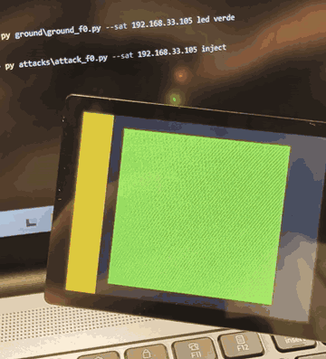

# CCSDS SDLS Ground Link

Asegurando un enlace tierra-satélite de extremo a extremo con CCSDS y SDLS, usando un ESP32-C5 (placa Waveshare ESP32-C5-Touch-LCD-2.8) como satélite simulado.

> **Estado: fase 3 de 4.** El enlace habla CCSDS real (tramas TC y TM, Space Packets, servicios PUS-lite y housekeeping) y está protegido con **SDLS (CCSDS 355.0-B) usando AES-256-GCM**: anti-replay persistente, eventos de seguridad, **rotación de claves en vuelo (OTAR)**, **COP-1 (FOP/FARM-1)** con retransmisión y defensa ante inundación. Las fases anteriores se conservan para comparar.

## El "antes": sin SDLS, cualquiera manda

La estación de tierra pone la carga útil (la pantalla) en verde. Después, un script atacante que no conoce ningún secreto inyecta un telecomando y el satélite lo acepta: la pantalla pasa a rojo. En la fase 2, este mismo ataque debe ser rechazado y quedar registrado en la telemetría.

## Antes y después de SDLS

| Ataque | Fase 1 (sin SDLS) | Fase 2 (con SDLS) | Control |
| --- | --- | --- | --- |
| Inyección de TC | Aceptado | Rechazado y notificado | MAC AES-GCM |
| Replay de una trama capturada | Aceptado | Rechazado, también tras reiniciar | IV como contador anti-replay, guardado en flash |
| Bit cambiado con CRC recalculado | Aceptado | Rechazado | MAC (el CRC no es autenticación) |
| Lectura de comandos y telemetría | Legible | Cifrado | AES-256-GCM |
| Secuestro de telemetría | El HK va al atacante | La TM solo va a la tierra autenticada | Origen autenticado, no por IP |
| IV gigante para bloquear a la tierra | No aplica | Sin efecto | Contador actualizado solo tras verificar la MAC |

Cada rechazo genera un **evento de seguridad** (servicio PUS 5,4) con el motivo, la IP de origen y el IV, que llega cifrado a la estación de tierra. Al emisor no se le responde nada.

## Fase 3: operar un enlace seguro

| Escenario | Sin la fase 3 | Con la fase 3 | Control |
| --- | --- | --- | --- |
| Clave TC filtrada | El atacante manda hasta que se reflashea | `rotar` y la clave vieja deja de servir | OTAR con KEK, anti-rollback (ADR-010) |
| Red que pierde el 40 % de los TC | Comandos perdidos sin aviso | Todos llegan, en orden | FOP con retransmisión (IV nuevo) + FARM-1 |
| Trama bypass (BD/BC) sin SDLS | — | Rechazada y notificada | SDLS antes que el FARM (ADR-011) |
| Inundación de 300 tramas falsas | 300 eventos que entierran la telemetría | 3 eventos + 1 resumen; la operación sigue | Límite de eventos (cubo de fichas) |
| Reinicio del satélite | — | Lockout visible, se resuelve con `sync` | FARM-1 + CLCW |

## Qué hay en el repositorio

| Pieza | Archivo | Qué hace |
| --- | --- | --- |
| Satélite F3 | `satellite/satellite_f3/` | F2 + `farm.cpp` (FARM-1), OTAR con KEK, claves en NVS, límite de eventos |
| Satélite F2 | `satellite/satellite_f2/` | Firmware con SDLS: `sdls.cpp` (mbedTLS), anti-replay en NVS, eventos de seguridad |
| Satélite F1 | `satellite/satellite_f1/` | Línea base CCSDS sin seguridad |
| Librería de tierra | `ground/ccsds/` | `frames.py` (TC/TM, Space Packets), `services.py` (PUS-lite), `sdls.py` (SDLS y OTAR), `cop1.py` (FARM-1), `keystore.py` (claves y contador de IV) |
| Estación de tierra | `ground/gs_f3.py`, `gs_f2.py`, `gs_f1.py` | Consolas de cada fase; la F3 incluye FOP, `rotar`, `sync` y `--perdida` |
| Atacante | `attacks/attack_f3.py`, `attack_f2.py`, `attack_f1.py` | `flood`, `bypass`, `filtrada`; `inject`, `forge`, `replay`, `tamper`, `espiar` |
| Herramientas | `tools/` | Generador de claves y satélites simulados en Python |
| Tests | `tests/` | Vectores, interoperabilidad C++ (mbedTLS) ↔ Python byte a byte y prueba de extremo a extremo de los ataques, en CI |

Guías paso a paso: [fase 0](GUIA_FASE0.md), [fase 1](GUIA_FASE1.md), [fase 2](GUIA_FASE2.md) y [fase 3](GUIA_FASE3.md).

## Hoja de ruta

1. **F0, preparación:** enlace UDP y control de la pantalla.
2. **F1, MVP sin seguridad:** tramas TC/TM CCSDS, Space Packets y servicios PUS-lite.
3. **F2, SDLS:** AES-256-GCM, anti-replay y eventos de seguridad en telemetría.
4. **F3, claves y FARM:** rekeying en vuelo, FARM-1 y escenarios de bypass e inundación. ← aquí
5. **F4, arquitectura:** threat model SPARTA, traza NIST SP 800-53, ADRs y policy-as-code.

## Decisiones de arquitectura

- [ADR-007: UDP sobre Wi-Fi como sustituto del enlace RF](docs/adr/ADR-007-udp-como-enlace-rf.md)
- [ADR-008: SDLS con AES-256-GCM y una clave por sentido](docs/adr/ADR-008-sdls-aes-gcm.md)
- [ADR-009: Anti-replay con el IV y contadores que sobreviven a reinicios](docs/adr/ADR-009-anti-replay-y-gestion-de-iv.md)
- [ADR-010: Rotación de claves en vuelo (OTAR) con una clave maestra](docs/adr/ADR-010-rotacion-de-claves-otar.md)
- [ADR-011: COP-1 por debajo de SDLS y límite de eventos ante inundación](docs/adr/ADR-011-cop1-e-inundacion.md)

## Ética

Proyecto educativo y defensivo. Los scripts de ataque solo se usan contra el propio C5, en la red propia.
