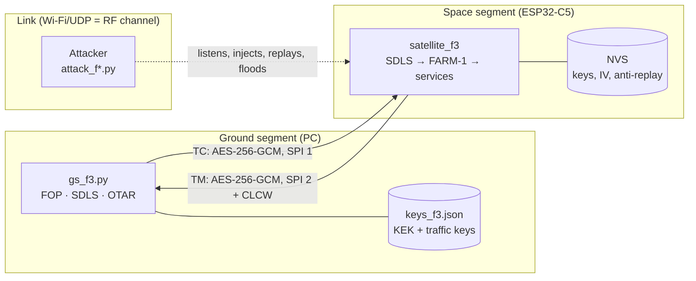

# Threat model of the ground-satellite link

- **Scope:** the TC/TM link between the ground station (Windows PC) and the simulated satellite (ESP32-C5), phases 1 to 3.
- **Framework:** [SPARTA](https://sparta.aerospace.org) from The Aerospace Corporation. It lists attack tactics and techniques against space systems, and their countermeasures (CM).
- **Method:** I tested each threat with a real attack script against the board, before and after each control. What I could not test is marked as "not tested".

## 1. System

**Trust boundaries:**
1. **The link.** Everything on it is treated as hostile (ADR-007). The source IP does not authorize anything.
2. **The ground key store.** Whoever can read it is in control.
3. **The satellite flash.** Not encrypted. I assume only the owner has physical access.

**Assets:**

| Asset | Why it matters |
| --- | --- |
| Command capability (TC) | Who sends commands controls the mission |
| Integrity and confidentiality of telemetry | Operations decisions based on fake or leaked data |
| Traffic keys and KEK | Losing them means losing the two assets above |
| Link availability | A satellite that does not listen to its ground is lost |

**Adversary:** on the same network (the same as having an antenna in view of the satellite). They can listen, inject, replay, modify and flood frames. They know the protocol and the SCID, which are public. They do not have the keys, except in the leaked key scenario.

## 2. Threats, controls and evidence

In the "Evidence" column, "board" means I tested it on the real board. File names are automatic tests.

| # | Threat | SPARTA technique | Phase 1 (no SDLS) | Control in place | SPARTA countermeasure | Evidence | Residual |
| --- | --- | --- | --- | --- | --- | --- | --- |
| T1 | Telecommand injection | IA-0008.01 (rogue ground station) | Accepted | AES-256-GCM MAC over header and data (ADR-008) | CM0031 Authentication, CM0002 COMSEC | `attack_f2 inject/forge` on board; `test_sdls`, `test_interop_f2` | Low |
| T2 | Replay of captured commands | EX-0001.01 (Replay: Command Packets) | Accepted | IV as anti-replay counter, saved in flash and checked after the MAC (ADR-009) | CM0031, CM0032 | `attack_f2 replay` on board, also after RST; `test_e2e_f2` | Low (see R1) |
| T3 | Frame tampering (the CRC is not authentication) | IMP-0011 (Command and Data Flow Manipulation) | Accepted if the CRC is computed again | MAC; header in the AAD | CM0031 | `attack_f2 tamper` on board; `test_sdls` | Low |
| T4 | Eavesdropping on commands and telemetry | EXF-0003.01 / .02 (Signal Interception, uplink and downlink) | Everything readable | AES-256-GCM encryption in both directions | CM0002 COMSEC | `attack_f2 sniff` on board | Low: metadata (SCID, N(S), IV) still in clear |
| T5 | Telemetry hijack | DE-0002 (Disrupt or Deceive Downlink) | HK goes to the attacker | TM only goes to the address of the last authenticated TC | CM0031 | `test_e2e_f2` and board (phase 2) | Low |
| T6 | Lock out the real ground with a huge IV | EX-0013.02 (Flooding: Erroneous Input) | Not applicable | The window only moves after a valid MAC | CM0032 | `attack_f2 forge` on board | Low |
| T7 | Skip controls with bypass/control frames | IA-0008.01 | Not applicable | SDLS runs on AD, BD and BC before the FARM (ADR-011) | CM0031, CM0055 Secure Command Mode(s) | `attack_f3 bypass` on board; `test_e2e_f3` | Low |
| T8 | Flood of fake frames | EX-0013.02 | Not applicable | Event limit (3 + 1/s) with a summary; limited redraw | CM0032 On-board IDS/IPS, CM0034 Monitor Critical Telemetry Points | `attack_f3 flood` on board (8 of 300 reached the program, 3 events and 1 summary); `test_e2e_f3` | Medium: the channel is still busy (R4) |
| T9 | Leaked traffic key | IA-0008.01 with valid credentials | Not applicable | In-flight rotation (OTAR) with KEK, anti-rollback and persistence (ADR-010) | CM0030 Crypto Key Management | `attack_f3 leaked` before and after `rotate`, on board; `test_e2e_f3` | Medium: exposure lasts until the leak is detected |
| T10 | Lost telecommands | none (reliability, not an attack) | Lost without notice | COP-1: FOP with retransmission (new IV) and FARM-1 | none | `--loss 0.4`; `test_e2e_f3` | Low |
| T11 | Fake the FARM state (CLCW) | DE-0002 | not applicable | None: the OCF is outside the MAC, like in the standard | none | Not tested | **Open** (R3) |
| T12 | Key extraction from the board | none (physical access) | not applicable | None | none | Not tested | **Open** (R2) |
| T13 | Theft of the ground key store | IA-0007 (Compromise Ground System) | not applicable | Excluded from Git; nothing else | CM0030 | none | **Open** (R2) |

I checked the SPARTA IDs on sparta.aerospace.org (November 2026). The names of the sub-techniques changed between versions of the framework, so I quote the ID.

## 3. Residual risks

| # | Risk | Level | Treatment |
| --- | --- | --- | --- |
| R1 | Anti-replay without an ARSN field or window, different from the policy baseline | Medium | Accepted: SDLS-020 and SDLS-021 in [accepted-risks.yaml](accepted-risks.yaml) |
| R2 | Keys in clear: JSON on ground and ESP32 flash | High | Accepted for the lab (MISSION-002). Fix: DPAPI or keyring on ground; flash encryption and secure boot on board |
| R3 | CLCW not authenticated | Medium | Open. Option: a second protected OCF, or report the FARM state in the encrypted HK |
| R4 | Channel flooding | Medium | Out of scope: on real RF it is a physical problem (antennas, spectrum) |
| R5 | A single KEK, no in-flight rotation for it | High | Open. Option: asymmetric key agreement (ECDH) to renew the KEK |
| R6 | No secure boot: firmware can be changed with physical access | Medium | Out of scope for the lab |
