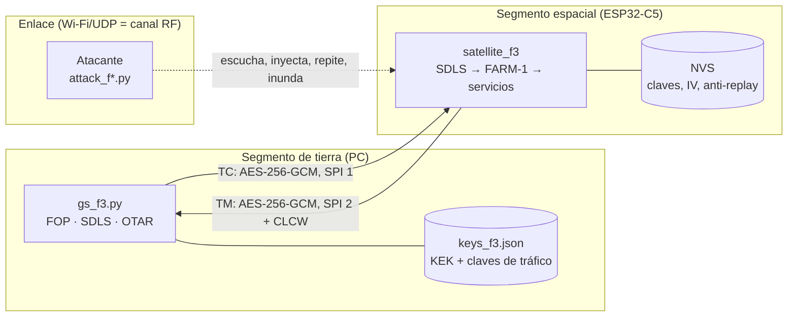

# Threat model del enlace tierra-satélite

- **Alcance:** enlace TC/TM entre la estación de tierra (PC con Windows) y el satélite simulado (ESP32-C5), fases 1 a 3.
- **Marco de referencia:** [SPARTA](https://sparta.aerospace.org) de The Aerospace Corporation, que cataloga tácticas y técnicas de ataque contra sistemas espaciales y sus contramedidas (CM).
- **Método:** cada amenaza se probó con un script de ataque real contra la placa, antes y después de cada control. Lo que no se pudo probar se marca como «no probado».

## 1. Sistema

**Fronteras de confianza:**
1. **El enlace:** todo lo que viaja por él se considera hostil (ADR-007). La IP de origen no autoriza nada.
2. **El almacén de claves de tierra:** quien lo lee, manda.
3. **La flash del satélite:** sin cifrar; se asume acceso físico solo del propietario.

**Activos:**

| Activo | Por qué importa |
| --- | --- |
| Capacidad de mando (TC) | Quien manda, controla la misión |
| Integridad y confidencialidad de la telemetría | Decisiones de operación basadas en datos falsos o filtrados |
| Claves de tráfico y KEK | Comprometerlas equivale a perder los dos activos anteriores |
| Disponibilidad del enlace | Un satélite que no escucha a su tierra está perdido |

**Adversario:** está en la misma red (equivale a tener una antena en visibilidad del satélite). Puede escuchar, inyectar, repetir, modificar e inundar tramas. Conoce el protocolo y el SCID, que son públicos. No tiene las claves, salvo en el escenario de clave filtrada.

## 2. Amenazas, controles y evidencia

En la columna «Evidencia», «placa» indica que se probó en la placa real; los nombres de archivo son tests automáticos.

| # | Amenaza | Técnica SPARTA | Fase 1 (sin SDLS) | Control implementado | Contramedida SPARTA | Evidencia | Residual |
| --- | --- | --- | --- | --- | --- | --- | --- |
| T1 | Inyección de telecomandos | IA-0008.01 (estación de tierra falsa) | Aceptado | MAC AES-256-GCM sobre cabecera y datos (ADR-008) | CM0031 Authentication, CM0002 COMSEC | `attack_f2 inject/forge` en placa; `test_sdls`, `test_interop_f2` | Bajo |
| T2 | Replay de comandos capturados | EX-0001.01 (Replay: Command Packets) | Aceptado | IV como contador anti-replay, guardado en flash y comprobado tras la MAC (ADR-009) | CM0031, CM0032 | `attack_f2 replay` en placa, también tras RST; `test_e2e_f2` | Bajo (ver R1) |
| T3 | Modificación de tramas (el CRC no es autenticación) | IMP-0011 (Command and Data Flow Manipulation) | Aceptado si se recalcula el CRC | MAC; cabecera en el AAD | CM0031 | `attack_f2 tamper` en placa; `test_sdls` | Bajo |
| T4 | Escucha de comandos y telemetría | EXF-0003.01 / .02 (Signal Interception, subida y bajada) | Todo legible | Cifrado AES-256-GCM en los dos sentidos | CM0002 COMSEC | `attack_f2 espiar` en placa | Bajo: los metadatos (SCID, N(S), IV) siguen en claro |
| T5 | Secuestro de la telemetría | DE-0002 (Disrupt or Deceive Downlink) | El HK va al atacante | La TM solo va a la dirección del último TC autenticado | CM0031 | `test_e2e_f2` y placa (fase 2) | Bajo |
| T6 | Bloquear a la tierra legítima con un IV gigante | EX-0013.02 (Flooding: Erroneous Input) | No aplica | La ventana solo avanza tras una MAC válida | CM0032 | `attack_f2 forge` en placa | Bajo |
| T7 | Saltarse controles con tramas bypass/control | IA-0008.01 | No aplica | SDLS se aplica a AD, BD y BC antes del FARM (ADR-011) | CM0031, CM0055 Secure Command Mode(s) | `attack_f3 bypass` en placa; `test_e2e_f3` | Bajo |
| T8 | Inundación de tramas falsas | EX-0013.02 | No aplica | Límite de eventos (3 + 1/s) con resumen; redibujado limitado | CM0032 On-board IDS/IPS, CM0034 Monitor Critical Telemetry Points | `attack_f3 flood` en placa (8 de 300 llegaron al programa, 3 eventos y 1 resumen); `test_e2e_f3` | Medio: el canal sigue ocupado (R4) |
| T9 | Clave de tráfico filtrada | IA-0008.01 con credenciales válidas | No aplica | Rotación en vuelo (OTAR) con KEK, anti-rollback y persistencia (ADR-010) | CM0030 Crypto Key Management | `attack_f3 filtrada` antes y después de `rotar`, en placa; `test_e2e_f3` | Medio: la ventana de exposición dura hasta que se detecta la fuga |
| T10 | Pérdida de telecomandos | — (fiabilidad, no ataque) | Pérdida silenciosa | COP-1: FOP con retransmisión (IV nuevo) y FARM-1 | — | `--perdida 0.4`; `test_e2e_f3` | Bajo |
| T11 | Falsear el estado del FARM (CLCW) | DE-0002 | — | Ninguno: el OCF va fuera de la MAC, como en el estándar | — | No probado | **Abierto** (R3) |
| T12 | Extracción de claves de la placa | — (acceso físico) | — | Ninguno | — | No probado | **Abierto** (R2) |
| T13 | Robo del almacén de claves de tierra | IA-0007 (Compromise Ground System) | — | Excluido de Git; nada más | CM0030 | — | **Abierto** (R2) |

Los identificadores SPARTA se comprobaron en sparta.aerospace.org (noviembre de 2026). Los nombres de las subtécnicas han cambiado entre versiones del marco, por eso se cita el identificador.

## 3. Riesgos residuales

| # | Riesgo | Nivel | Tratamiento |
| --- | --- | --- | --- |
| R1 | Anti-replay sin campo ARSN ni ventana, distinto del baseline de políticas | Medio | Aceptado: SDLS-020 y SDLS-021 en [riesgos-aceptados.yaml](riesgos-aceptados.yaml) |
| R2 | Claves en claro: JSON en tierra y flash del ESP32 | Alto | Aceptado para el laboratorio (MISSION-002). Remediación: DPAPI o keyring en tierra; flash encryption y secure boot a bordo |
| R3 | CLCW sin autenticar | Medio | Pendiente. Opción: un segundo OCF protegido, o informar del estado del FARM en el HK cifrado |
| R4 | Inundación del canal | Medio | Fuera de alcance: en RF real es un problema físico (antenas, espectro) |
| R5 | Una sola KEK, sin rotación en vuelo | Alto | Pendiente. Opción: acuerdo de claves asimétrico (ECDH) para renovar la KEK |
| R6 | Sin secure boot: firmware modificable con acceso físico | Medio | Fuera de alcance del laboratorio |
